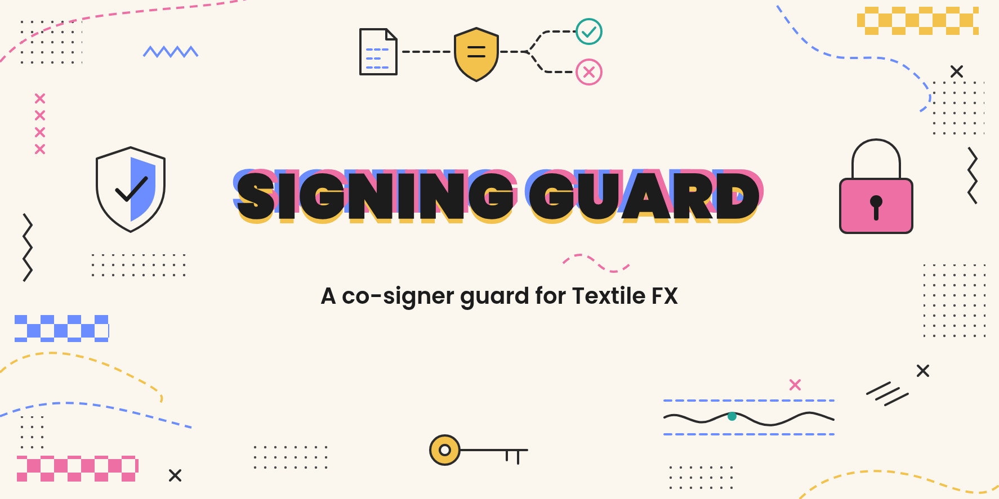

<picture>
  <source media="(prefers-color-scheme: dark)" srcset="assets/signing-guard-readme-header-dark.png">
  <source media="(prefers-color-scheme: light)" srcset="assets/signing-guard-readme-header-light.png">
  
</picture>

# Signing Guard

A Fireblocks API Co-Signer [Callback Handler](https://developers.fireblocks.com/reference/authenticate) that approves only the signatures a [Stitch](https://github.com/textile-protocol/textile-stitch) market-making bot needs, and rejects everything else.

It runs on the operator's own infrastructure next to their API Co-Signer. The co-signer sends every signing request from the bot's API user to the guard before it signs. The guard checks the request against a policy file the operator controls and answers APPROVE or REJECT. If the guard is down, slow, misconfigured or unsure, nothing gets signed.

Textile maintains the software. The operator runs it, owns its config and keys, and re-verifies every change to either. Textile never sees the handler key and is not in the signing path.

## Why it exists

Fireblocks' Transaction Authorization Policy decides *who* may sign for *which vault*. It does not read the contents of a typed message. A market-making bot's Typed Message rule has to auto-approve so it can answer RFQs inside the venue's window, so without a content check, anyone holding the bot's API credential could sign any EIP-712 message for the vault: a Permit2 order paying the vault's inventory to themselves at any price, or an EIP-2612 `permit` under a token's own domain.

With the guard in place, a stolen bot credential can only get signatures over:

- Permit2 orders that pull one of two configured tokens from the vault and pay the other back to the vault, through the configured reactor, within a band around the operator's reference price, under a per-order size cap, with a short deadline.
- Venue authentication messages (`MakerSession`, `MakerEnroll`) that name the vault and the configured domains and chain.
- Optionally, Stitch's `SignerCheck` connectivity probe, which authorises nothing.
- Optionally, one contract call: an ERC-20 `approve(Permit2, amount)` on a configured token, at or under a cap.

What it does not do:

- **Judge trades.** An attacker with the credential can still make the vault trade at the edge of the band, up to the size cap, as often as the venue accepts orders. The band and the cap bound the loss per order; they do not remove it. Revoking the Permit2 allowance or the API user in the Fireblocks console is the stop button.
- **Verify the price source.** If the configured ticker is wrong, or its book can be pushed around, the band moves with it. The guard fails closed when the source is unreachable, stale, too wide, malformed or outside the configured price range, but it cannot detect a plausible wrong price inside that range.
- **Track state.** It knows nothing about inventory, nonces, venue state or fills. It judges each request on its own.
- **Protect its own host.** Someone who can edit the config or replace the image can change the policy. Pin the image digest and keep the config under change control. Someone between the co-signer and the guard still cannot forge an approval: responses are signed with the handler key.

## How it works

The guard implements Fireblocks' JWT callback flow ("Option 1" in their [secure communication](https://developers.fireblocks.com/reference/cosigner-callbackhandler-secure-communication-authentication) guide):

1. The co-signer sends `POST /v2/tx_sign_request` with an RS256 JWT as the body. The guard verifies it with the co-signer's public key. A token that does not verify, uses any other `alg`, or is not a JWT gets HTTP 401 and no decision.
2. The guard parses the transaction strictly. For a typed message it pins `types` to one of the four exact shapes Stitch produces, decodes every field by its declared type, refuses undeclared fields, and recomputes the EIP-712 digest with viem. When Fireblocks also sends `rawTx[].payload` (the hash the co-signer will sign), every payload must equal that digest.
3. It evaluates the policy ([docs/policy.md](docs/policy.md)) and answers with a JWT signed by its own RSA key: `{ "action": "APPROVE" | "REJECT", "requestId", "rejectionReason" }`.
4. `POST /v2/config_change_sign_request` is answered REJECT by default. The bot's API user never initiates configuration changes.

Fireblocks fails a request whose handler does not answer within 30 seconds, and a REJECT fails the transaction outright instead of routing it to a human. That is what makes the guard fail closed: an unreachable guard stops all signing for the API user.

Every decision is one JSON line on stdout. No key material, tokens or request bodies are logged.

## Quick start

The quickest way to run it is `quickstart/`: the guard behind [Caddy](https://caddyserver.com), which gets a free HTTPS certificate for your domain and only lets your co-signer's IP through. On a server with Docker and a domain pointing at it:

```sh
git clone --depth 1 https://github.com/textile-protocol/textile-signing-guard
cd textile-signing-guard/quickstart
# add your keys and policy, then set GUARD_DOMAIN and COSIGNER_IP in .env
docker compose up -d
```

[Getting started](https://github.com/textile-protocol/textile-signing-guard/wiki/Getting-started) walks through it in eight short steps. The image is `ghcr.io/textile-protocol/textile-signing-guard`, built for linux/amd64 and linux/arm64 by this repository's release workflow.

## Documentation

- [Wiki](https://github.com/textile-protocol/textile-signing-guard/wiki): a short explainer of how the guard works and how to run it.
- [docs/policy.md](docs/policy.md): every rule, in order, with its reason code, and how the reference price works.
- [docs/configuration.md](docs/configuration.md): every config key and its default.
- [docs/operations.md](docs/operations.md): deployment, image pinning, health checks, logs, upgrades, the acceptance suite, and what to confirm on a live Fireblocks workspace.
- [docs/audit.md](docs/audit.md): what has been reviewed and what came out of it.
- [SECURITY.md](SECURITY.md): how to report a vulnerability.

## Development

```sh
npm ci --ignore-scripts
npm test              # compiles with tsc (the type check), then runs node --test
```

Node 22 or later; the image runs Node 24. The one runtime dependency is `viem`, pinned exactly, for `hashTypedData` and address handling: it is the EIP-712 implementation the rest of the Textile stack signs with, and `test/fixtures/stitch-typed-data.json` (dumped from Stitch's Rust code) proves the digests match. JWTs use `node:crypto` directly, RS256 only.

```
src/
  cli.ts          serve, check-config, healthcheck, acceptance, version
  config.ts       the policy file, parsed and validated strictly
  audit.ts        JSON-lines decision log
  callback/       Fireblocks callback protocol: HTTP routes, RS256 JWTs, request payload
  policy/         the decision: dispatch, EIP-712 pinning and hashing, order/venue/approve rules
  price/          exact rational math, the Luno ticker, the reference snapshot and its poller
  acceptance/     the acceptance suite and the Stitch message builders it sends
test/             mirrors src/, plus the Stitch fixtures
```

The decision path (`callback/`, `policy/`, `price/`) is small enough to read in one sitting. Start at `policy/decide.ts`.

## License

[AGPL-3.0-or-later](LICENSE).
